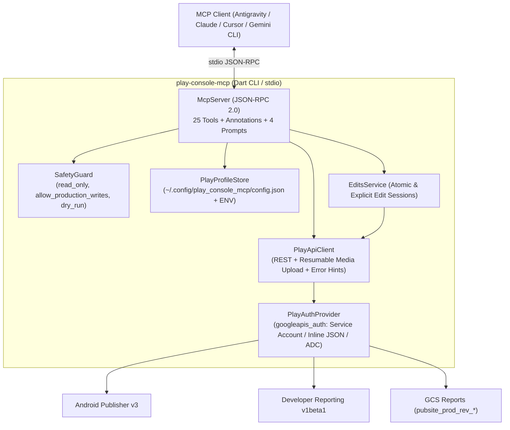

# play-console-mcp

[](https://github.com/brktlhylmz/play-console-mcp/actions/workflows/ci.yml)
[](LICENSE)
[](https://dart.dev)
[](https://modelcontextprotocol.io)

A lightweight, open-source **Model Context Protocol (MCP)** server written in pure Dart for automating **Google Play Console** workflows from Antigravity, Claude Desktop, Cursor, Windsurf, and Gemini CLI.

Unifies **Android Publisher API v3**, **Google Play Developer Reporting API v1beta1**, and **Google Cloud Storage Play Bulk Reports (`pubsite_prod_rev_*`)** behind **25 action-oriented MCP tools**, **4 built-in prompts**, **atomic `edits` transactions**, **Google Resumable Uploads**, and strict **Production Safety Guards**.

---

## Why This Exists?

1. **Google Play Has Three Separate APIs, Not One:**
   - App discovery (`apps:search`), all **10 Android Vitals** metric sets, grouped crash/ANR stack traces, and anomaly alerts live in **Play Developer Reporting API v1beta1** — which Dart's official `googleapis` package currently omits.
   - Releases, tracks, store listings, reviews, modern monetization (`subscriptions` & `oneTimeProducts`), purchases v2, orders, and app recovery live in **Android Publisher API v3**.
   - Historical installs, ratings trends, reviews older than 7 days, sales, and earnings are exported exclusively as **UTF-16LE CSVs** into a developer **Google Cloud Storage** bucket (`pubsite_prod_rev_*`).
   - `play-console-mcp` brings all three together behind one authenticated Dart CLI with only two lightweight runtime dependencies (`googleapis_auth` and `http`).

2. **Safe by Default for AI Agents (`SafetyGuard`):**
   - Tools publish MCP `ToolAnnotations` (`readOnlyHint`, `destructiveHint`, `idempotentHint`).
   - Optional **`read_only`** mode (`PLAY_CONSOLE_READ_ONLY=true`) blocks all mutations.
   - **`allow_production_writes`** defaults to **`false`**: mutations targeting the `production` track, order refunds, subscription cancellations/revocations, user/grant deletions, bulk deletions, or App Recovery deployments fail closed unless explicitly allowed or confirmed per call (`confirm_production: true` / `confirm_destructive: true`).
   - Write tools support **`dry_run: true`** (validate and discard edits), **`changes_not_sent_for_review: true`**, and **`ERROR_IF_IN_REVIEW`** (default) so active Google reviews are never silently cancelled.

3. **Modern 2026 Play API Support:**
   - Supports **`monetization.onetimeproducts`** (purchase options & offers) alongside legacy `inappproducts` read fallback.
   - Supports **`edits.images.upload` `aiGeneratedState`**, **`purchases.subscriptionsv2`**, **`purchases.productsv2`**, **`Fastlane` metadata directory sync/export** (`title` 30 / `short_description` 80 / `full_description` 4000 / `reply_text` 350 pre-validation), and **Google Resumable Media Upload** for large `.aab`/`.apk`/debug symbol uploads.

---

## Architecture



---

## Installation

### Prerequisites
- **Dart SDK** `>= 3.9.0` (bundled with modern Flutter SDKs)
- A **Google Cloud Service Account** with Play Console permissions (setup guide below)

### Install Globally from GitHub (or Local Clone)

```bash
# Install directly from GitHub:
dart pub global activate --source git https://github.com/brktlhylmz/play-console-mcp.git

# Or clone locally and compile a native binary / activate:
git clone https://github.com/brktlhylmz/play-console-mcp.git
cd play-console-mcp
make get
make activate      # or `make build-exe` for ./build/play-console-mcp
```

---

## Step-by-Step Quickstart

1. **Enable APIs in Google Cloud Console (`console.cloud.google.com`):**
   - Select or create a Google Cloud project and enable both APIs under **APIs & Services > Library**:
     - **Google Play Android Developer API** (`androidpublisher.googleapis.com`)
     - **Google Play Developer Reporting API** (`playdeveloperreporting.googleapis.com`)

2. **Create a Service Account & Download the JSON Key:**
   - Open **IAM & Admin > Service Accounts** -> **Create Service Account**.
   - Copy its email address (`...@<project-id>.iam.gserviceaccount.com`).
   - Open **Keys > Add Key > Create new key > JSON** and move the key outside any Git repository (e.g. `~/.config/play_console_mcp/service-account.json` with `chmod 600`).

3. **Invite the Service Account in Google Play Console (`play.google.com/console`):**
   - Go to **Users and permissions** -> **Invite new users**.
   - Paste the Service Account email address, select the target apps, and assign least-privilege permissions:
     - Read-only vitals & inspection: *View app information (read-only)*
     - Releases, listings & reviews: *Release to testing tracks / production*, *Manage store presence*, *Reply to reviews*
     - GCS bulk CSV reports: *View financial data*
   > **Cross-Account Tip:** Google no longer requires linking a Google Cloud project in Play Console. Even if your Google Cloud project and your Google Play Console developer account belong to **completely different Google/Gmail accounts**, inviting the `...@*.iam.gserviceaccount.com` address directly under **Users and permissions** works out of the box.

4. **Verify Access with `--doctor`:**
   ```bash
   play-console-mcp --doctor \
     --package com.example.app
   ```
   Or using environment variables before saving a profile:
   ```bash
   PLAY_CONSOLE_SERVICE_ACCOUNT_PATH=~/.config/play_console_mcp/service-account.json \
     play-console-mcp --doctor --package com.example.app
   ```

5. **Add to Your MCP Client Configuration:**

#### Antigravity / Claude Desktop / Cursor / Windsurf (`mcp_config.json`)

```json
{
  "mcpServers": {
    "play-console": {
      "command": "play-console-mcp",
      "env": {
        "PLAY_CONSOLE_SERVICE_ACCOUNT_PATH": "/absolute/path/to/service-account.json",
        "PLAY_CONSOLE_DEFAULT_PACKAGE": "com.example.app",
        "PLAY_CONSOLE_READ_ONLY": "false",
        "PLAY_CONSOLE_ALLOW_PRODUCTION_WRITES": "false"
      }
    }
  }
}
```

Or run via `dart pub global run` without adding `~/.pub-cache/bin` to `PATH`:

```json
{
  "mcpServers": {
    "play-console": {
      "command": "dart",
      "args": ["pub", "global", "run", "play_console_mcp:play-console-mcp"],
      "env": {
        "GOOGLE_APPLICATION_CREDENTIALS": "/absolute/path/to/service-account.json"
      }
    }
  }
}
```

#### Optional Agent Skill Installation
```bash
play-console-mcp --install-skill
```
This writes [skill/SKILL.md](skill/SKILL.md) to `~/.gemini/config/skills/play-console-mcp/SKILL.md` (and `~/.claude/skills/play-console-mcp/SKILL.md` if `~/.claude` exists).

---

## Multi-Profile Configuration (`config.json`)

Profiles can be saved via `manage_play_profiles` (`action: "save"`) and are stored in `~/.config/play_console_mcp/config.json` with `0600` file permissions:

```json
{
  "default_profile_id": "staging",
  "profiles": {
    "staging": {
      "profile_id": "staging",
      "label": "Staging / QA Account",
      "service_account_path": "/Users/dev/.config/play_console_mcp/sa-staging.json",
      "default_package_name": "com.example.app.staging",
      "read_only": false,
      "allow_production_writes": false,
      "default_changes_not_sent_for_review": false
    },
    "production": {
      "profile_id": "production",
      "label": "Production Publisher",
      "service_account_path": "/Users/dev/.config/play_console_mcp/sa-prod.json",
      "default_package_name": "com.example.app",
      "developer_id": "1234567890123456789",
      "gcs_bucket_id": "pubsite_prod_rev_01234567890123456789",
      "read_only": false,
      "allow_production_writes": false,
      "default_changes_not_sent_for_review": true
    },
    "analytics-ro": {
      "profile_id": "analytics-ro",
      "label": "Read-Only Vitals & Reviews",
      "service_account_path": "/Users/dev/.config/play_console_mcp/sa-prod.json",
      "default_package_name": "com.example.app",
      "gcs_bucket_id": "pubsite_prod_rev_01234567890123456789",
      "read_only": true,
      "allow_production_writes": false,
      "default_changes_not_sent_for_review": false
    }
  }
}
```

### Authentication Precedence
1. Saved profile `service_account_path` (selected via `profile` tool argument or `PLAY_CONSOLE_PROFILE`)
2. `PLAY_CONSOLE_SERVICE_ACCOUNT_JSON` (raw JSON string — ideal for CI/Docker)
3. `PLAY_CONSOLE_SERVICE_ACCOUNT_PATH`
4. `GOOGLE_APPLICATION_CREDENTIALS`
5. Application Default Credentials (`gcloud auth application-default login` or GCE metadata)

---

## Safety Guards & Production Protection

| Guard / Flag | Default | Effect |
|---|---|---|
| `read_only` / `PLAY_CONSOLE_READ_ONLY` | `false` | Blocks all non-read-only tool calls unless `dry_run: true`. |
| `allow_production_writes` / `PLAY_CONSOLE_ALLOW_PRODUCTION_WRITES` | `false` | Gates `production` track writes, `orders.refund`, `subscriptionsv2.cancel`/`revoke`, `users.delete`/`grants.delete`, `listings.deleteall`, `images.deleteall`, `monetization.*.delete`, and `apprecovery.deploy`. Pass `confirm_production: true` or `confirm_destructive: true` per call to override after explicit user sign-off. |
| `dry_run` | `false` | Executes edit changes against Play APIs, calls `edits.validate`, and deletes the temporary edit without committing. |
| `changes_not_sent_for_review` / `PLAY_CONSOLE_CHANGES_NOT_SENT_FOR_REVIEW` | `false` | Commits changes into *Publishing overview* in Play Console without entering the automatic review queue. |
| `changes_in_review_behavior` | `ERROR_IF_IN_REVIEW` | Prevents accidentally cancelling an already active Play review; override with `CANCEL_IN_REVIEW_AND_SUBMIT` only when intended. |

---

## Example Agent Prompts

- *"Run `doctor` on my Play Console profile and list all accessible apps."*
- *"Check Android Vitals crash rate, ANR rate, LMK rate, and active anomalies for `com.example.app` over the last 14 days."*
- *"Show the top crash error issues with sample stack traces for versionCode 142."*
- *"Fetch all unanswered 1-star and 2-star reviews from the last 7 days translated into English, and draft replies under 350 characters for my review."*
- *"Upload `./build/app/outputs/bundle/release/app-release.aab` and `mapping.txt` to the `internal` track with `en-US` and `tr-TR` release notes (do a `dry_run` first)."*
- *"Promote the latest `beta` release to a 10% `production` staged rollout."*
- *"Read the latest monthly `installs` and `earnings` CSV reports from Play GCS."*

---

## MCP Tools Reference (25 Tools)

### Profiles, Discovery & Edit Sessions
| Tool | Actions / Capabilities | Mode |
|---|---|---|
| `manage_play_profiles` | `list`, `save`, `set_default`, `remove`, `doctor` (auth & 3-API health probe) | Mixed |
| `list_accessible_apps` | Discover all accessible Play Console apps (`playdeveloperreporting` `apps:search`) | Read |
| `manage_edit_session` | `create`, `get`, `validate`, `commit` (`changes_not_sent_for_review`, `changes_in_review_behavior`), `delete` | Write |

### Releases, Tracks & Artifacts
| Tool | Actions / Capabilities | Mode |
|---|---|---|
| `list_tracks_and_releases` | `list_tracks`, `get_track`, `list_releases`, `country_availability`, `release_filter_options` | Read |
| `manage_track_release` | `create_track`, `update_track`, `promote_release`, `update_rollout`, `halt_rollout`, `resume_rollout`, `complete_rollout` (`dry_run`, localized release notes) | Write / Guarded |
| `upload_app_artifact` | `upload_bundle` (`.aab` resumable), `upload_apk`, `upload_deobfuscation` (`proguard`/`nativeCode`), `upload_internal_sharing`, `list_bundles`, `list_apks` | Write |
| `manage_generated_and_system_apks` | `list_generated`, `download_generated`, `list_system_variants`, `create_system_variant`, `download_system_variant` | Mixed |

### Store Presence & User Reviews
| Tool | Actions / Capabilities | Mode |
|---|---|---|
| `manage_app_details` | `get`, `update` (`default_language`, `contact_email`, `contact_phone`, `contact_website`) | Write |
| `manage_store_listings` | `list`, `get`, `update`, `patch`, `delete`, `delete_all`, `sync_from_fastlane_dir`, `export_to_fastlane_dir` (30/80/4000 limit checks) | Write / Guarded |
| `manage_store_images` | `list`, `upload` (supports `ai_generated_state`), `delete`, `delete_all` | Write / Guarded |
| `get_reviews` | `list` (`translation_language`, `min_rating`/`max_rating`, `unanswered_only`), `get` *(last 7 days API window)* | Read |
| `reply_to_review` | Post or update reply (`<= 350` chars pre-validated) | Write |

### Android Vitals & Reporting
| Tool | Actions / Capabilities | Mode |
|---|---|---|
| `query_android_vitals` | `query`, `describe` across **all 10 metric sets**: `crash_rate`, `anr_rate`, `slow_start_rate`, `slow_rendering_rate`, `excessive_wakeup_rate`, `stuck_background_wakelock_rate`, `lmk_rate`, `anon_rss_memory`, `bitmap_memory`, `error_counts` | Read |
| `search_error_issues_and_reports` | `search_issues` (grouped crash/ANR clusters + sample stack traces), `search_reports` | Read |
| `list_vitals_anomalies` | List automated Play Vitals anomaly alerts | Read |

### Monetization, Purchases & Orders
| Tool | Actions / Capabilities | Mode |
|---|---|---|
| `manage_subscriptions` | `list`, `get`, `create`, `patch`, `delete`, `activate_base_plan`, `deactivate_base_plan`, `delete_base_plan`, `migrate_prices` | Write / Guarded |
| `manage_subscription_offers` | `list`, `get`, `create`, `patch`, `activate`, `deactivate`, `delete` | Write / Guarded |
| `manage_one_time_products` | Modern `oneTimeProducts` (`list`, `get`, `patch`, `delete`, `update_purchase_options_state`, `list_offers`, `activate_offer`, `deactivate_offer`, `cancel_offer`) + `legacy_list` / `legacy_get` | Write / Guarded |
| `convert_region_prices` | Convert base currency amount into localized Google Play country prices (`pricing:convertRegionPrices`) | Read |
| `manage_purchases` | `get_subscription_v2`, `cancel_subscription_v2`, `defer_subscription_v2`, `revoke_subscription_v2`, `get_product_v2`, `get_product_legacy`, `acknowledge_product`, `consume_product`, `list_voided_purchases` | Mixed / Guarded |
| `manage_orders` | `get`, `batch_get`, `refund` (`revoke` supported), `review_refund` | Mixed / Guarded |

### Operations, Compliance, Team & Bulk GCS Reports
| Tool | Actions / Capabilities | Mode |
|---|---|---|
| `manage_app_recovery` | `list`, `create`, `add_targeting`, `deploy`, `cancel` | Mixed / Guarded |
| `manage_compliance_and_targeting` | `upload_data_safety_csv`, `list_device_tier_configs`, `get_device_tier_config`, `create_device_tier_config` | Mixed |
| `manage_testers_and_team` | `get_testers`, `update_testers` (Google Groups), `list_users`, `create_user`, `patch_user`, `delete_user`, `create_grant`, `patch_grant`, `delete_grant` | Mixed / Guarded |
| `query_play_gcs_reports` | `list_reports`, `read_report` (`installs`, `ratings`, `crashes`, `store_performance`, `reviews`, `sales`, `earnings` — auto UTF-16LE BOM decode & totals) | Read |

### Built-in MCP Prompts (4)
- `release_readiness_audit` — Inspect tracks, anomalies, crash/ANR/LMK vitals, and recent low-star reviews before shipping.
- `triage_crashes` — Pull anomalies and top `errorIssues` stack traces prioritized by affected users.
- `draft_review_replies` — Fetch unanswered recent reviews and draft 350-char-compliant replies for approval.
- `prepare_release_notes` — Convert changelog notes into localized 500-char Google Play "What's new" maps.

---

## Known Google Play API Limitations

Google Play Console does **not** expose public APIs for the following web-only features:
- Creating a brand-new app or uploading the very first `.aab`/`.apk` (must be done once manually in Play Console UI).
- Reading/appealing **Policy Status** violations or filling sensitive permission declarations (aside from `applications.dataSafety` CSV upload).
- Accessing **Pre-launch Report** test lab screenshots, videos, or accessibility crawler traces.
- Managing **Custom Store Listings (CSLs)**, **Store Listing A/B Experiments**, or **Promotional Content (LiveOps)**.
- Clicking **Managed Publishing** "Publish changes" after Google approves a release (*holding before review* via `changes_not_sent_for_review: true` **is** supported).
- Managing closed-track testers by individual email list (`edits.testers` supports Google Groups only).

---

## Troubleshooting

- **`403 Forbidden` right after inviting a Service Account:** Ensure both `androidpublisher.googleapis.com` and `playdeveloperreporting.googleapis.com` are enabled in Google Cloud Console and the Service Account has app access in Play Console > **Users and permissions**. Play Console permission propagation can take up to 24 hours; saving a minor app metadata change in the web UI often forces an immediate refresh.
- **`400` mentioning `changesNotSentForReview`:** A previous submission was likely rejected or requires manual dispatch. Retry with `changes_not_sent_for_review: true` so the edit is staged in **Publishing overview**.
- **`403 Forbidden` on `inappproducts`:** Migrated app catalogs block legacy `inappproducts` writes. Use `manage_one_time_products` modern actions (`patch`, `update_purchase_options_state`, `activate_offer`, etc.).
- **Missing older reviews in `get_reviews`:** Google's `reviews` REST API only returns reviews created or updated within the last 7 days. Use `query_play_gcs_reports` (`category: "reviews"`) for historical review archives.

---

## Development

```bash
make get          # dart pub get
make check        # dart format check + dart analyze --fatal-infos + dart test
make smoke        # CLI flags & live stdio JSON-RPC initialize / tools/list / prompts/list check
```

## Contributing & Community

- Contributions, issues, and feature requests are welcome! See [CONTRIBUTING.md](CONTRIBUTING.md) and our [Code of Conduct](CODE_OF_CONDUCT.md).
- Please review [SECURITY.md](SECURITY.md) before reporting credential or security findings, and see [CHANGELOG.md](CHANGELOG.md) for release history.

## License

MIT License — Copyright (c) 2026 Burak Talha Yılmaz. See [LICENSE](LICENSE).
